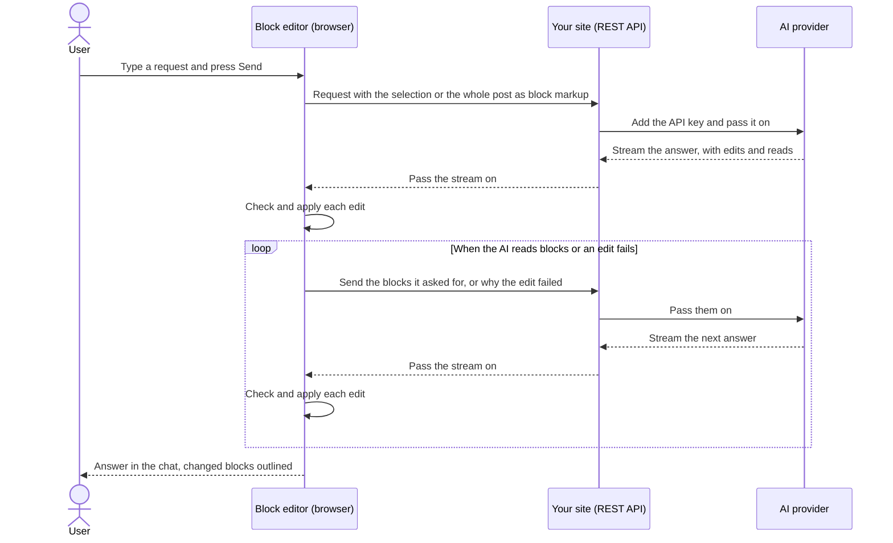

# Blocktune – AI Block Editing Chat

[](https://github.com/t-hamano/blocktune/actions/workflows/test.yml)


Select blocks or text in the block editor and edit them by chatting with AI. The plugin uses the API keys registered on the Connectors screen in WordPress core.


## Features

### Edit What You Select, or the Whole Post

Open the Blocktune sidebar from the sparkle icon in the top toolbar. Select one or more blocks, or just a few words inside a block, and tell the AI what you want to change. With nothing selected, the AI reads the whole post and decides where to edit, insert, or delete blocks. Changed blocks are outlined and changed text is highlighted, and every edit is a single undo step.

### Knows Your Site, Saves Tokens

The AI automatically knows your site's blocks and theme presets, so its edits fit your site. Long posts are sent as an outline and the AI reads only the parts it needs, and repeated context is cached, keeping token usage low. Each answer shows the tokens it used.

### Streaming Answers

Answers from Anthropic, OpenAI, and Google stream into the chat as they are written, so you don't have to wait for the whole reply.

### Built on WordPress Connectors

The plugin uses the API keys registered on the Connectors screen in WordPress core, so there are no extra keys to manage. Press the gear icon to choose from the providers and models available through your connectors, and your choice is saved for each user.

## Requirements

* WordPress 7.1 or later
* PHP 8.3 or later
* An AI provider plugin, such as AI Provider for Anthropic, with an API key on the Connectors screen

## How it works



The API key stays on your site and is never sent to the browser. Every edit is checked and applied in the browser, and when an edit fails, the reason goes back to the AI so it can try again.

## Limitations

* Only administrators can use the AI assistant, and only super admins on a multisite network. There is no setting to allow other roles.
* The AI edits the blocks of the post, page, template, template part, or pattern you are editing. Global Styles, and the content of template parts, synced patterns, and navigation menus placed inside it, are out of scope. Edit those in their own editor.
* The AI does not search the web, read other web pages, or add new images or files. It works from what you send and what the model already knows.
* Long posts (over about 60,000 characters of block markup) are sent as an outline, so the AI may miss context it did not read.
* Each answer keeps one PHP worker busy for up to 5 minutes. On servers or proxies that hold streamed answers back, long answers can fail with a timeout error.
* Your content is sent to the AI provider. See the "External services" section of [readme.txt](readme.txt) for what is sent and when.

## How to build

```sh
npm install
npm run build
```

## How to evaluate

`npm run eval` sends a few fixed requests to a real model and checks what the assistant did, to measure changes to the prompt or the token use, and adds the results to the history in the repository. See [scripts/eval/README.md](scripts/eval/README.md).

## Author

[Aki Hamano (GitHub)](https://github.com/t-hamano)
